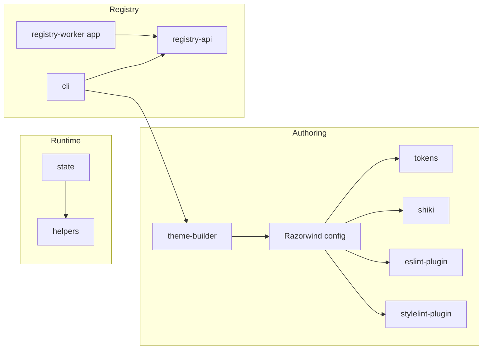

# Package map

Cyclone UI is a set of [Tamagui](https://tamagui.dev) based design components. You copy the components into your project with the [CLI](./cli.md). The packages in `packages/` support that workflow. This section documents each package.

For the design system itself (components, tokens, fonts, and icons), see the [design system docs](../design-system/index.md).

## Packages

| Package | Published | Purpose |
| --- | --- | --- |
| [`@cyclone-ui/cli`](./cli.md) | Yes | The `cyclone-ui` command. Copies components, compares them with the registry, and builds a Tamagui config. |
| [`@cyclone-ui/helpers`](./helpers.md) | Yes | Helpers that turn Tamagui tokens into sizes and font styles. Also the form-control context. |
| [`@cyclone-ui/state`](./state.md) | Yes | Theme mode, toast messages, form and field state, and Jotai atom helpers. |
| [`@cyclone-ui/tokens`](./tokens.md) | Yes | The generated Tamagui config, CSS themes, and token source files. |
| [`@cyclone-ui/theme-builder`](./theme-builder.md) | Yes | Razorwind plugins that preprocess tokens and generate the Tamagui config. |
| [`@cyclone-ui/shiki`](./shiki.md) | Yes | Six Shiki themes for syntax highlighting. |
| [`@cyclone-ui/eslint-plugin`](./eslint-plugin.md) | Yes | ESLint rules for design tokens and components. |
| [`@cyclone-ui/stylelint-plugin`](./stylelint-plugin.md) | Yes | Stylelint rules for design tokens. |
| [`@cyclone-ui/registry-api`](./registry-api.md) | No (private) | The tRPC router and client for the component registry. |

"Published" means that `package.json` does not set `"private": true`. The root README states that the packages are not yet released to npm. Check the registry before you install.

## How the packages fit together



*Packages and the arrows between them. An arrow means "uses".*

- `razorwind.config.ts` uses the `theme-builder` plugins. Razorwind generates files in `tokens`, `shiki`, `eslint-plugin`, and `stylelint-plugin` from the token JSON files.
- `state` depends on `helpers`.
- `cli` depends on `registry-api` and `theme-builder`.
- The [registry worker](../../apps/registry-worker/README.md) app serves `registry-api`. The [Storybook](../../apps/storybook/README.md) app uses `helpers`, `state`, and `tokens`.

## Generated files

Razorwind generates many files in these packages. Do not edit them by hand. Change `razorwind.config.ts` or the token JSON files in `packages/tokens/src/tokens`. Then run:

```bash
pnpm nx run monorepo:generate-themes
```

## Apps

| App | Purpose |
| --- | --- |
| [`registry-worker`](../../apps/registry-worker/README.md) | A Cloudflare Worker that serves the registry API. |
| [`storybook`](../../apps/storybook/README.md) | A private Storybook for the components. |

## Next steps

- Start with the [CLI](./cli.md) to add components to a project.
- Read [`@cyclone-ui/state`](./state.md) to learn about theme and form state.
